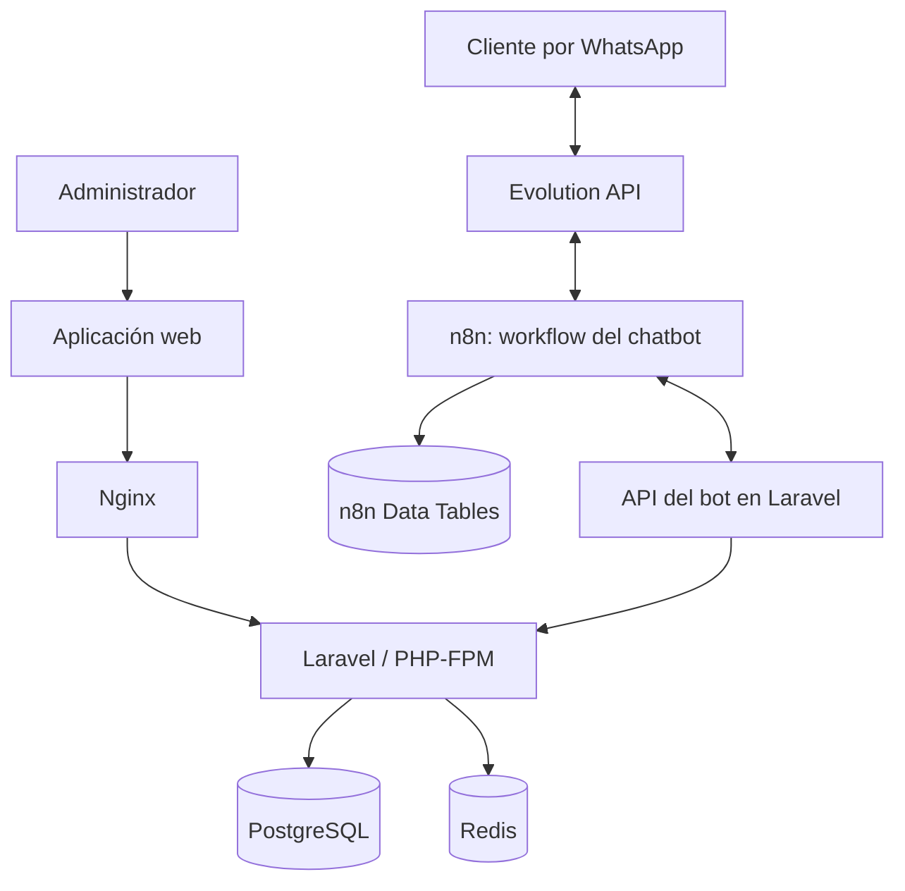

<div align="center">

# 💈 BarberKing

### Sistema de gestión para barberías con chatbot de WhatsApp

**Administra servicios, barberos, horarios y citas desde una aplicación web; permite que tus clientes consulten disponibilidad, agenden y gestionen sus citas por WhatsApp.**


[**Instalación completa**](manual_instalacion.md) · [**Workflow de WhatsApp**](n8n_data/flow/BarberKing_Flow_n8n_WhatsApp.json) · [**Inicio rápido**](#-inicio-rápido)

</div>

---

## 📖 Acerca del proyecto

**BarberKing** es una solución de gestión de barberías que integra un **panel administrativo web** con un **chatbot conversacional de WhatsApp**. El objetivo es organizar la operación cotidiana de una barbería y facilitar la atención a los clientes sin depender de una persona para cada solicitud de reserva.

El backend, desarrollado en Laravel, centraliza las reglas de negocio y el almacenamiento en PostgreSQL. El chatbot utiliza n8n para coordinar conversaciones, Evolution API para comunicarse con WhatsApp y endpoints del propio Laravel para consultar información real y gestionar reservas.

> **Estado del proyecto:** desarrollo académico con funcionalidades principales de administración y chatbot implementadas. Su utilización en un entorno público o de producción requiere pruebas, revisión de seguridad, gestión de secretos y configuración de infraestructura adecuadas.

## ✨ Funcionalidades

### 🖥️ Administración web

- **Autenticación y perfil:** registro, inicio de sesión y administración de datos de la cuenta.
- **Servicios:** creación, consulta, actualización y eliminación de servicios de barbería, con información de precio y duración.
- **Horarios:** gestión de la disponibilidad y turnos de los barberos.
- **Citas:** agendamiento, consulta y administración de reservas; actualización de estados desde el panel.
- **Experiencia de usuario:** interfaz adaptable a diferentes pantallas, formularios validados, mensajes en español, confirmaciones y notificaciones.

### 📱 Chatbot de WhatsApp

- Menú interactivo basado en mensajes de texto.
- Consulta del catálogo de servicios y sus características.
- Consulta de horarios disponibles por servicio, barbero y fecha.
- Registro de clientes y agendamiento de citas mediante consultas a Laravel.
- Consulta de las citas asociadas a un cliente y cancelación de citas elegibles.
- Estado de conversación persistido en **n8n Data Tables** para continuar procesos de varios mensajes.
- Verificación de documento y celular antes de permitir la gestión de citas.
- Validación de celulares colombianos: **10 dígitos, comenzando por 3**, para los formularios conversacionales correspondientes.

> El comportamiento concreto del bot depende de la versión del JSON importado y de la configuración de su instancia. WhatsApp **no funciona** solo por iniciar los contenedores: requiere vincular una cuenta e integrar n8n y Evolution API.

## 🧱 Tecnologías

| Capa | Tecnologías |
|---|---|
| Backend | Laravel 12, PHP 8.2, API REST |
| Base de datos de la aplicación | PostgreSQL 15 |
| Interfaz | Blade, Tailwind CSS 4, Alpine.js, JavaScript, Vite 7 |
| Componentes de interfaz | SweetAlert2, Flatpickr |
| Automatización del chatbot | n8n 2.x |
| Integración WhatsApp | Evolution API 2.3.7 |
| Servicios auxiliares | Redis 7, Nginx |
| Orquestación | Docker y Docker Compose |

**Versiones de referencia:** observadas en el diagnóstico local del **18 de noviembre de 2026**: Laravel `12.69.3`, PHP `8.2.35`, PostgreSQL `15.20`, Redis `7.4.12`, n8n `2.47.7`, Evolution API `2.3.7`, Node.js de la aplicación `20.20.2` y Nginx `1.31.8`. No representan una garantía de que todas las instalaciones o versiones futuras utilicen exactamente los mismos parches.

## 🏗️ Arquitectura



### Componentes de Docker

| Servicio de Compose | Función | Acceso local de referencia |
|---|---|---|
| `app` | Ejecuta Laravel con PHP-FPM | Interno, puerto 9000 |
| `webserver` | Sirve la aplicación mediante Nginx | `http://localhost:8000` |
| `db` | Base de datos PostgreSQL de BarberKing | Puerto 5432, según Compose |
| `redis` | Servicio Redis | Interno, puerto 6379 |
| `n8n` | Editor y ejecución del chatbot | `http://localhost:5678` |
| `evolution-api` | Conexión con WhatsApp | `http://localhost:8080` |

Los puertos anteriores corresponden al entorno local documentado. Revisa los mapeos del archivo de Docker Compose si realizas cambios de configuración.

### Flujo de una conversación

1. Un cliente envía un mensaje al WhatsApp Business vinculado.
2. **Evolution API** recibe el evento y lo entrega al webhook de **n8n**.
3. n8n interpreta la intención y consulta o actualiza el estado de la conversación en `barberking_conversaciones`.
4. Cuando necesita información del negocio, n8n realiza peticiones a la **API de Laravel**, autenticadas mediante el encabezado configurado.
5. Laravel consulta PostgreSQL y aplica las validaciones pertinentes.
6. n8n prepara la respuesta y la envía mediante Evolution API.

## 🚀 Inicio rápido

**Requisitos:** Git, Docker Desktop / Docker Engine y Docker Compose, además de acceso a Internet para descargar imágenes y dependencias.

1. **Clona el repositorio:**

   ```bash
   git clone <URL_DEL_REPOSITORIO>
   cd BarberKing
   ```

2. **Prepara el entorno** (PowerShell):

   ```powershell
   Copy-Item .env.example .env
   ```

   Configura **tu propio `.env`** siguiendo los nombres y opciones reales del archivo de ejemplo. No compartas ni subas credenciales a Git.

3. **Construye e inicia los servicios:**

   ```bash
   docker compose up --build -d
   ```

4. **Comprueba el estado:**

   ```bash
   docker compose ps
   ```

5. **Abre la aplicación:** `http://localhost:8000`.

6. **Completa manualmente la integración de WhatsApp** siguiendo el [manual de instalación](manual_instalacion.md). Debes configurar n8n, sus credenciales y Data Table; importar y publicar el workflow; configurar Evolution API y escanear el código QR desde WhatsApp Business.

> ⚠️ **El comando Docker inicia la infraestructura, pero no deja el chatbot listo por sí solo.** La instalación de Laravel aprovecha las tareas previstas en el *entrypoint* del proyecto, mientras que la configuración de n8n y Evolution API se realiza manualmente.

## 📚 Manual de instalación

La guía detallada se encuentra en **[`manual_instalacion.md`](manual_instalacion.md)** e incluye:

- Preparación y verificación de la aplicación web y sus contenedores.
- Creación de la Data Table `barberking_conversaciones` con las columnas necesarias.
- Creación de las credenciales **`BarberKing - Evolution API`** (`apikey`) y **`BarberKing - Laravel Bot API`** (`X-Bot-Api-Key`).
- Importación del archivo [`BarberKing_Flow_n8n_WhatsApp.json`](n8n_data/flow/BarberKing_Flow_n8n_WhatsApp.json).
- Reconexión de las referencias a Data Tables y credenciales en los nodos importados.
- Configuración del webhook de Evolution API y vinculación de WhatsApp mediante QR.
- Pruebas funcionales y resolución de incidencias habituales.

**Importante:** exportar el workflow a JSON **no** incluye automáticamente las Data Tables, sus registros, los secretos de credenciales ni la sesión vinculada de WhatsApp.

## 🗂️ Estructura general del repositorio

```text
BarberKing/
├── app/                         # Lógica de aplicación Laravel
├── bootstrap/                   # Arranque de Laravel
├── config/                      # Configuración de Laravel
├── database/                    # Migraciones y seeders
├── docker/                      # Configuración auxiliar de contenedores
├── public/                      # Entrada pública y recursos compilados
├── resources/                   # Vistas y archivos frontend
├── routes/                      # Rutas web y API
├── tests/                       # Pruebas de Laravel (si están presentes)
├── n8n_data/
│   └── flow/
│       └── BarberKing_Flow_n8n_WhatsApp.json
├── .env.example                 # Plantilla de configuración
├── Dockerfile                   # Imagen de la aplicación
├── docker-compose.yml           # Orquestación Docker (según diagnóstico)
├── manual_instalacion.md        # Instalación completa
└── README.md                    # Presentación del proyecto
```

La estructura es orientativa; comprueba los nombres concretos en la versión del repositorio que hayas clonado.

## 🛠️ Comandos útiles

```bash
# Consultar los contenedores
docker compose ps

# Revisar logs de la aplicación
docker compose logs --tail=100 app

# Revisar logs del chatbot
docker compose logs --tail=100 n8n

# Revisar logs de Evolution API
docker compose logs --tail=100 evolution-api

# Reiniciar los servicios
docker compose restart

# Detener los contenedores, conservando los volúmenes
docker compose down
```

**No uses `docker compose down -v` sin tener un respaldo y comprender sus efectos:** la opción `-v` elimina volúmenes administrados por Compose y puede borrar bases de datos, credenciales, estados de conversación y sesiones persistidas.

## 🔐 Seguridad y tratamiento de datos

- **Nunca publiques** `.env`, credenciales reales, claves API ni datos de sesiones de WhatsApp.
- Utiliza claves distintas para Evolution API y el middleware del bot en Laravel.
- Protege el acceso a la interfaz de n8n, a la aplicación administrativa y a las bases de datos.
- La verificación de identidad del bot mediante documento y celular **no equivale** a un sistema robusto de autenticación; revisa su modelo de seguridad antes de un despliegue público.
- Implementa copias de seguridad de PostgreSQL y de los datos persistentes de n8n / Evolution API conforme a la arquitectura real.
- Evita incluir información personal de clientes o conversaciones en capturas, issues o ejemplos públicos.

## 🧪 Pruebas funcionales recomendadas

Una vez completada la instalación:

- [ ] La aplicación web carga y permite autenticarse.
- [ ] Los servicios, barberos y horarios se visualizan correctamente.
- [ ] Se puede crear una cita y actualizar su estado desde el panel.
- [ ] n8n tiene el workflow importado y publicado.
- [ ] `barberking_conversaciones` y las dos credenciales están configuradas.
- [ ] Evolution API tiene una instancia vinculada mediante QR.
- [ ] El bot responde al menú de WhatsApp.
- [ ] El cliente puede consultar servicios y disponibilidad real.
- [ ] Es posible registrar al cliente y agendar una cita por WhatsApp.
- [ ] El bot rechaza celulares que no tengan exactamente 10 dígitos o que no comiencen por `3`.
- [ ] Un documento inexistente recibe un mensaje apropiado al intentar gestionar citas.
- [ ] Un cliente verificado puede consultar y cancelar una cita elegible.
- [ ] Los cambios se reflejan de forma consistente entre el panel web y el chatbot.

## 🤝 Contribuciones

Este repositorio forma parte de un proyecto académico. Si colaboras en él:

1. Revisa el [manual de instalación](manual_instalacion.md) y sigue las convenciones del código existente.
2. Crea una rama para tus cambios, cuando el flujo de trabajo del equipo así lo requiera.
3. Evita subir archivos con secretos, datos personales o volúmenes de Docker.
4. Describe claramente los cambios y las pruebas realizadas en cada contribución.
5. Si editas el chatbot en n8n, **exporta la versión actualizada del workflow** al archivo versionado antes de realizar el commit.

---

<div align="center">

**BarberKing** · Gestión de barberías y reservas conectadas a WhatsApp 💈

*Proyecto desarrollado con Laravel, PostgreSQL, Docker, n8n y Evolution API.*

</div>
